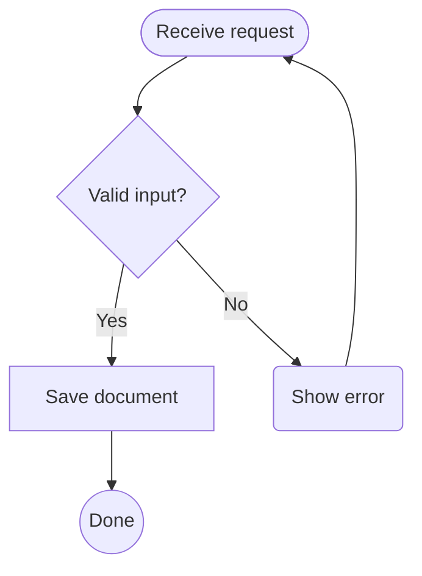

# pele-rs

An independent Rust engine for Mermaid flowcharts, inspired by
[Pele](https://github.com/obsidianmd/pele). One implementation for native Swift
and browser WebAssembly. MIT licensed; not an official Obsidian or Mermaid project.

**Pre-alpha.** This is a deliberately bounded first flowchart slice, not a complete
Pele or Mermaid replacement. No performance or full compatibility claims.

The engine owns parsing, graph layout, edge routing and SVG generation. Rust
shapes bundled Noto Sans and emits glyph outlines: diagrams need no installed
fonts, JavaScript renderer or web view. Results include structured geometry and
accessible labels alongside portable SVG. Hosts supply resolved theme colors.

## Scope

- `flowchart` and `graph`; `TB`, `TD`, `BT`, `LR`, `RL` directions.
- Bare nodes, rectangles `[label]`, rounded rectangles `(label)`, diamonds
  `{label}`, circles `((label))`, stadiums `([label])`.
- Solid `-->` and `---`, dashed `-.->` and `-.-`, thick `==>` links.
- Pipe labels `-->|label|`, chains, repeated node declarations, semicolons,
  quoted labels, line comments, branches, joins, disconnected nodes, cycles,
  self-loops and parallel links.
- Left-to-right labels covered by the bundled font; missing glyphs and
  unsupported directionality return explicit errors.

Unsupported syntax returns an error, never a silently simplified diagram:
subgraphs, `classDef`/`class`/`style`/`linkStyle`, `click`, directives/frontmatter,
Markdown labels, rich shape metadata, `&` fan-out and other diagram families.
Plain labels are data, not HTML. Layout is independently implemented and is not
pixel-identical to Pele.

## Architecture

[Astra's low-level design](docs/LLD.md) specifies the contracts and first-slice
limits. The library has no Kamui dependency. Kamui can consume the Rust crate or
its thin Swift/WASM adapters like any other application.

## Attribution

Pele reference revision: `458322a5b8abb1ae57ddf127c32017ab9fb14a92`.
See [NOTICE](NOTICE), [Pele's license](third_party/PELE-LICENSE), and
[font provenance](assets/fonts/README.md). Engine code is MIT; the bundled font
retains its SIL Open Font License.
