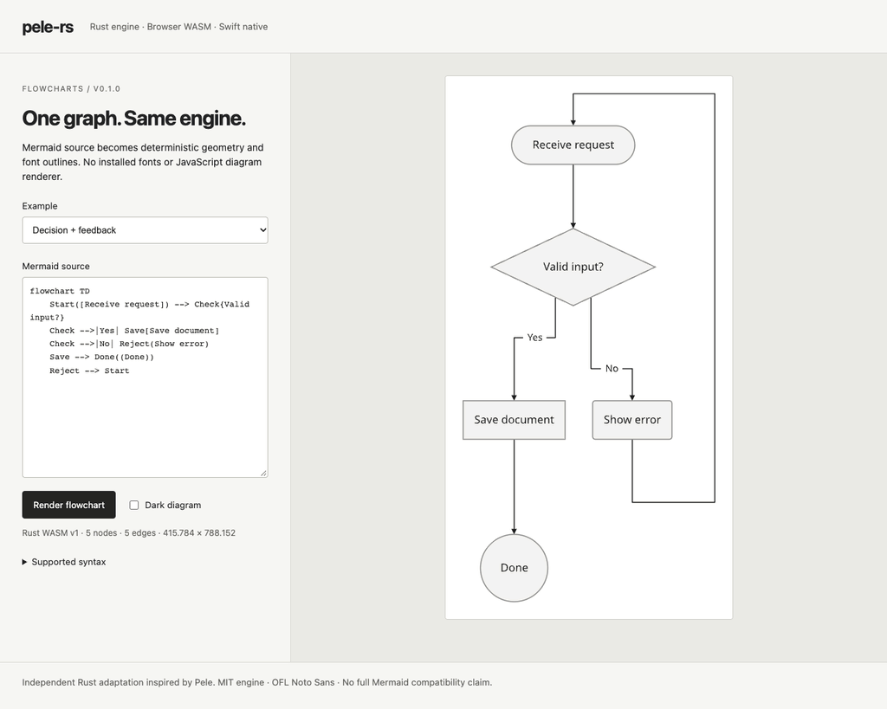

# pele-rs

[](https://github.com/vijayksingh/pele-rs/actions/workflows/ci.yml)
[](https://github.com/vijayksingh/pele-rs/releases/latest)
[](LICENSE)

**Mermaid flowcharts, one Rust engine. Native Swift and browser WebAssembly.**

Parse source, lay out graphs, route edges, and produce portable SVG plus structured
geometry. One embedded font shapes labels on every target. No installed fonts,
web view, runtime JavaScript diagram renderer, or Kamui dependency.



Recorded from the real playground after verification; [reproduction script](scripts/record-demo.mjs).

**v0.1.0 covers a documented flowchart subset.** Independent Rust adaptation
inspired by [Pele](https://github.com/obsidianmd/pele); not an official
Obsidian/Pele/Mermaid release or full Mermaid replacement. Layout is independently
implemented. No upstream pixel-equivalence or speedup claims.

## Full Pele compatibility work

The complete Pele library is the target: all 33 diagram families, public APIs,
shared layout/text/theme behavior and Swift/web adapters. The required
[architecture](docs/FULL_PARITY_LLD.md) and [parity inventory](docs/PELE_PARITY.md)
account for all 287 pinned upstream source files. **Full parity is not released.**

The development compatibility interface adds typed `DiagramModule` and
`RenderResources` seams, an owned `ParsedDocument`, source preparation and truthful
capability discovery. Its separate v2 contract preserves the released v1 renderer.
Open extension IDs and `parse_as` allow additional languages without editing the
built-in detector. New modules retain their concrete model types; parsed documents keep the
handler/config that created them, including after registry replacement. Twenty-one
compatibility renderers are implemented: **flowchart, pie, quadrantChart, packet,
radar, timeline, journey, kanban, mindmap, class, ER, XYChart, state, Gantt, sequence, GitGraph, Architecture, Sankey, Treemap, C4 and Info**. Their 289,355 pinned model/SVG/error
scenarios pass through Rust, Swift/C and browser WASM. The remaining 12 families
and remaining public APIs still require implementation/verification.

Source preparation is checked against pinned upstream examples and generated cases.
Build native/WASM artifacts from source to use the development Swift `Pele.inspect`
and web `@unlocalhosted/pele-rs/core` APIs. The development `Pele.Engine` and web
`@unlocalhosted/pele-rs/full` APIs add owned parsed documents, host measurement/icon
callbacks, and native SVG palette resolution. The released Swift binary remains v0.1;
its matching legacy API stays available without a local build. See
[development verification](docs/FULL_PARITY_PROGRESS.md) for current evidence and
remaining work. Detection alone does not imply parsing/rendering support.
Current browser measurements show no speedup over Pele JS; see the scoped
[performance baseline](docs/PERFORMANCE.md). GPU acceleration is not implemented.

## Install

### Rust

Tagged Git dependency; not published to crates.io yet:

```toml
[dependencies]
pele = { package = "pele-rs", git = "https://github.com/vijayksingh/pele-rs.git", tag = "v0.1.0" }
```

```rust
let diagram = pele::render(
    "flowchart LR; A[Capture] --> B{Keep?} --> C([Store])",
    &pele::RenderOptions::default(),
)?;
// diagram.svg, diagram.width, diagram.height, diagram.geometry
```

### Swift

macOS 14+, Swift 6+. Root package downloads a checksum-pinned **universal
arm64 + x86_64 XCFramework** from the release:

```swift
// Package.swift dependencies:
.package(url: "https://github.com/vijayksingh/pele-rs.git", from: "0.1.0")
// Target dependencies:
.product(name: "Pele", package: "pele-rs")
```

```swift
import Pele
let diagram = try Pele.render("flowchart LR; A[Hello] --> B{Ready?}")
// AppKit can display this engine's outlined SVG:
// NSImage(data: Data(diagram.svg.utf8))
```

[Swift build details](bindings/swift/README.md). No iOS or Windows binaries included.

### Web

GitHub release tarball; not published to npm registry yet:

```sh
npm install https://github.com/vijayksingh/pele-rs/releases/download/v0.1.0/unlocalhosted-pele-rs-0.1.0.tgz
```

```js
import { loadPele, PeleError } from '@unlocalhosted/pele-rs';
const pele = await loadPele();
const diagram = pele.render('flowchart LR; A[Hello] --> B[World]');
document.querySelector('#diagram').innerHTML = diagram.svg;
```

Serve over HTTP. Bundlers that relocate WASM can pass its emitted URL to
`loadPele(wasmURL)`; package exports `@unlocalhosted/pele-rs/pele.wasm`.
Rendering is synchronous after initialization. [Web package details](bindings/web/README.md).

All artifacts and SHA-256 checksums: [v0.1.0 release](https://github.com/vijayksingh/pele-rs/releases/tag/v0.1.0).

## Supported flowcharts


- Headers `flowchart` / `graph`; TB, TD, BT, LR, RL directions.
- Shapes `[rectangle]`, `(rounded)`, `{diamond}`, `((circle))`, `([stadium])`.
- Links `-->`, `---`, `-.->`, `-.-`, `==>`; pipe labels and chains.
- Forks, joins, skip edges, cycles, self-loops, parallel links, disconnected nodes.
- Plain labels, double quotes for delimiters, `\"`, `\\`, `\n` escapes,
  multiline labels, covered left-to-right Unicode and combining marks.
- ASCII IDs `[A-Za-z_][A-Za-z0-9_]*`; newline/semicolon separators, `%%` comments,
  CRLF. Last explicit declaration wins; references preserve existing labels/shapes.

**Unsupported syntax returns structured errors.** Subgraphs, full Mermaid ID
syntax, extended/rich shapes, `&` fan-out, classes/styles, frontmatter/directives,
HTML/Markdown formatting, callbacks, external links/images, other diagram families,
font fallback and bidi are deferred. HTML-looking labels remain literal data.
Uncovered glyphs and RTL text fail explicitly.

## Interface

Rust: `parse`, `layout`, `render_svg`, convenience `render`. Foreign adapters share
one versioned JSON render operation. Graph/layout internals remain private.

Results include SVG and `geometry.version = 1`: ordered node IDs, labels, shapes,
bounds; ordered edge endpoints, styles, polylines and label bounds. Coordinates use
top-left origin, x right, y down, quantized to 0.001 units. Virtual nodes do not leak.

Options accept concrete `#RRGGBB` theme colors, font sizes, spacing, padding,
radius, stroke width and accessible title. Unknown fields/invalid ranges fail.
Use Rust/JS `font_size`, Swift `fontSize`. No arbitrary CSS or host font callbacks.

Errors carry stable `code`, `message`, optional UTF-8 byte `span` and one-based
line/Unicode-scalar column. Rust returns `Result`; Swift/JS throw `PeleError`.
Normal input errors do not poison the engine; WASM traps require reloading its
page/worker.

Outlined text is portable but not selectable. Escaped titles, labels and geometry
retain text for accessible consumers; playground source is editable and exposed.
Geometry enables future interaction, not automatic editable app-native nodes.

## Limits

| Resource | Ceiling |
| --- | --- |
| Source / options | 256 KiB / 16 KiB UTF-8 |
| Nodes / edges | 256 / 1,024 |
| Identifier / label | 128 / 4,096 bytes |
| Lines per label / glyphs per diagram | 64 / 65,536 |
| Virtual route vertices | 8,192 |
| Canvas side | 100,000 units |
| SVG / JSON result | 8 MiB / 16 MiB |

Not every graph below graph ceilings fits routing/canvas budgets: `layout_limit`
reports failure to reserve valid space. PNG example caps allocation at 16M pixels.

## Build and verify

Needs rustup (pinned Rust **1.98.1**), matching wasm-bindgen CLI **0.2.128**, Node
20+, npm. Native builds require macOS/Xcode and Swift 6+.

```sh
git clone https://github.com/vijayksingh/pele-rs.git
cd pele-rs
rustup toolchain install 1.98.1 --profile minimal --component rustfmt
rustup target add --toolchain 1.98.1 wasm32-unknown-unknown
cargo install wasm-bindgen-cli --version 0.2.128 --locked
npm ci --ignore-scripts
npx playwright install chromium firefox webkit
scripts/build-native.sh
scripts/build-wasm.sh
npm run serve
# http://127.0.0.1:5191/examples/web/
```

`scripts/verify.sh` runs Rust integration, packaged Rust consumer, real C lifetime
checks, Swift corpus, AppKit pixels, separate SwiftPM consumer, Pele semantic
comparison and packed-WASM browser tests. Local Chromium uses installed Google
Chrome; CI uses Playwright Chromium. Firefox/WebKit use pinned binaries. One worker.

[Verification report](docs/VERIFICATION.md): ten rendered fixture SVG/geometry
results match exactly across Rust, Swift/C and three browser engines; twelve
rejections match error envelopes. Further checks cover varied workflows, all
directions, high fan-in, limits, independent XML/raster consumers and determinism.
All tests cross public interfaces; no unit tests.

`scripts/package-release.sh` builds universal native/WASM artifacts, verifies the
crate, computes checksums and updates Swift's distribution manifest; it does not
publish. After verification, `npm run demo` against the served playground recreates
the GIF (ffmpeg required).

## Architecture and attribution

[Astra's LLD](docs/LLD.md) defines parser, bounded layered layout, cycle return
lanes, shaping, ownership and verification. [UPSTREAM.md](UPSTREAM.md) maps our
implementation to Pele revision `458322a5b8abb1ae57ddf127c32017ab9fb14a92` and
records compatibility differences.

Engine: [MIT](LICENSE). Pele attribution: [NOTICE](NOTICE),
[upstream license](third_party/PELE-LICENSE). Bundled unmodified Noto Sans remains
[SIL OFL 1.1](crates/pele/assets/fonts/OFL.txt), with pinned
[origin/hash](crates/pele/assets/fonts/README.md).
[Third-party notices](THIRD_PARTY_NOTICES.md). No system font redistributed.
