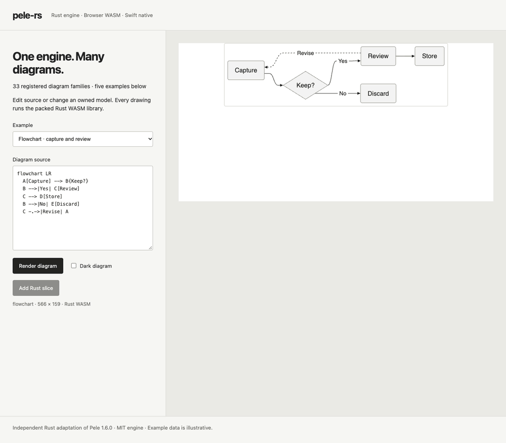

# pele-rs

[](https://github.com/vijayksingh/pele-rs/actions/workflows/ci.yml)
[](https://github.com/vijayksingh/pele-rs/releases/latest)
[](LICENSE)

**Pele-compatible diagrams, one independent Rust engine for Swift and the web.**

**The engine implements all 33 diagram families** from
[Pele 1.6.0](https://github.com/obsidianmd/pele). Rust owns parsing, models,
layout and SVG generation. Thin C/Swift and WebAssembly adapters expose the same
engine, with host font, icon, clock, calendar and presentation resources.
The project has no Kamui dependency and runs no JavaScript diagram engine in its
native or WASM distribution.

The Rust, universal macOS and packed-browser verification covers all 33 families.
Use the [v0.2.0 GitHub release](https://github.com/vijayksingh/pele-rs/releases/tag/v0.2.0)
for the previous all-family build and verification records. Current development
removes the v1-only APIs for 0.3.0; use source builds until the new release is published.
Packages are distributed through GitHub, not crates.io or the npm registry.



Recorded from the actual packed-library playground with
[asserted interactions](scripts/record-full-demo.mjs). The
[playground](examples/web/full.html) uses the same WASM engine as the package.

## Diagram families

All 33 have Rust parsers/renderers and mutable model codecs:

| | Families |
| --- | --- |
| Graphs and structure | Flowchart, Swimlane, Class, ER, State, Architecture, Block, Mindmap, TreeView |
| Time and workflow | Sequence, Gantt, Timeline, Journey, Kanban, GitGraph, AgentFlow, EventModeling |
| Charts and data | Pie, QuadrantChart, Packet, Radar, XYChart, Sankey, Treemap, Venn |
| Systems and explanation | C4, Requirement, Railroad, Cynefin, Wardley, Usecase, Ishikawa, Info |

Compatibility is pinned to upstream revision
`458322a5b8abb1ae57ddf127c32017ab9fb14a92`. Implemented families do not by
themselves establish complete API or release acceptance. The
[parity inventory](docs/PELE_PARITY.md) tracks the complete library, and
[provenance](UPSTREAM.md) records its relationship to upstream. This is an
independent project, not an official Obsidian, Pele or Mermaid release.

## Install

### Rust

The Cargo package is named `pele-rs`; the dependency below aliases it as `pele`.
Use the source checkout for the current API:

```toml
[dependencies]
pele = { package = "pele-rs", path = "/absolute/path/to/pele-rs/crates/pele" }
```

```rust
use pele::compat::{Engine, RenderOptions, text::MetricsResources};

fn main() -> Result<(), Box<dyn std::error::Error>> {
    let engine = Engine::with_builtins();
    let drawing = engine.render_source(
        "pie\n\"Swift\":2\n\"Web\":3",
        &RenderOptions::default(),
        &mut MetricsResources,
    )?;
    println!("{}", drawing.rendered.svg);
    Ok(())
}
```

`MetricsResources` supplies Rust's fallback measurement. Hosts can implement
`RenderResources` for their actual fonts and resources. Use `Engine::parse` and
`render_document` to retain a parsed document. The separate
`compat::public::PublicEngine` exposes owned mutable graphs, schema-described
methods and direct model construction.

### Swift

macOS 14+, Swift 6+. Run `scripts/build-native.sh --universal` before resolving
the local package. In the application's `Package.swift`:

```swift
// dependencies:
.package(path: "/absolute/path/to/pele-rs")
// Target dependencies:
.product(name: "Pele", package: "pele-rs")
```

```swift
import Pele

let engine = Pele.Engine()
let document = try engine.parse("pie\n\"Swift\":2\n\"Web\":3")
let drawing = try engine.render(document)
// drawing.svg, drawing.width, drawing.height, drawing.links
```

Use `parseMutable` for editable owned models, or `parsePrepared` /
`createPrepared` for low-level per-family models. The AppKit layer supplies
`DiagramView`, mount/update/destroy, zoom, link/accessibility controls and
explicitly approved native image resources. See
[native entries](docs/NATIVE_DIAGRAM_ENTRIES.md),
[mutable models](docs/MUTABLE_MODELS.md) and
[Swift build details](bindings/swift/README.md). No iOS or Windows binaries are
included.

### Web

Build the current package:

```sh
scripts/build-wasm.sh
npm install /absolute/path/to/pele-rs/dist/release/unlocalhosted-pele-rs-0.3.0.tgz
```

```js
import {loadRenderer} from '@unlocalhosted/pele-rs/full';

const renderer = await loadRenderer();
const model = renderer.parse('pie\n"Swift":2\n"Web":3');
model.sections.set('Rust', 5);
const drawing = renderer.render(model);
document.querySelector('#diagram').innerHTML = drawing.svg;
renderer.dispose(model);
```

Serve over HTTP. Initialization is asynchronous; parse/render are synchronous
afterward. `loadRenderer(wasmURL)` accepts a relocated WASM URL. The package also
exports `./core`, independent `./registry`, `./lazy`, and all 33 `./diagrams/*`
entries. Low-level entries accept parsed or caller-authored models after
`loadDiagramEntries()`. The built-ins share one WASM binary; lazy family selection
does not download separate native modules. See
[web interfaces](bindings/web/README.md),
[registry contracts](bindings/web/REGISTRY.md) and
[caller-authored models](docs/DECLARED_MODEL_CONSTRUCTION.md).

## Extending the engine

`DiagramModule<Model>` keeps new languages behind a typed parser/render interface;
`Engine::empty()`, open diagram IDs and explicit `parse_as` support independent
registries. A document retains the handler and config that created it, even after
registry replacement. `RenderResources` keeps fonts, icons, time and platform
services outside diagram logic.

The mutable interface adds `PublicDiagramModule` and owned model graphs. New
providers opt into their own graph codecs and constructors; unsupported
construction fails explicitly. Graph exchange preserves aliases, cycles, UTF-16
code units and IEEE number bits without making Swift or JavaScript implement the
diagram renderer. See the [architecture](docs/FULL_PARITY_LLD.md),
[public model design](docs/LLD_PUBLIC_MODELS.md) and
[construction contract](docs/DECLARED_MODEL_CONSTRUCTION.md).

## Compatibility and limits

The port compares source preparation, complete models, method mutations, SVG,
errors and ordered callbacks with the pinned Pele oracle through public
integration and browser tests. Test counts and artifact identities belong to
specific revisions; [the progress log](docs/FULL_PARITY_PROGRESS.md) separates
completed slices from final acceptance.

Native transport and work budgets remain enforced independently of Pele's
source, edge and output options. Source/config use bounded UTF-8/JSON domains;
mutable graph strings use lossless UTF-16 transport. Arbitrary JavaScript VM
behavior, custom getters/prototype interpreters and every undeclared helper
replacement are outside the current contract. A declared plain model can expose
an upstream missing-helper error; the constructor does not invent parser state.
See [source limits](docs/SOURCE_LIMITS.md), [parse limits](docs/PARSE_LIMITS.md),
[output limits](docs/OUTPUT_LIMITS.md),
[intrinsic diagnostics](docs/WEB_VM_DIAGNOSTICS.md) and
[extreme corpus boundaries](docs/WEB_LEGACY_CORPUS.md).

Host font metrics can affect drawing dimensions. Rust renders SVG using resources
provided by the host. Source, retained-model and mutable-model APIs use this same engine.

There is no claimed speedup over Pele JavaScript. Existing measurements are
scoped historical baselines; GPU acceleration is not implemented. See
[performance evidence](docs/PERFORMANCE.md).

## Build and verification

Tooling: pinned Rust **1.98.1**, matching wasm-bindgen CLI **0.2.128**, Node 20+
and npm. Swift requires macOS/Xcode and Swift 6+.

```sh
rustup toolchain install 1.98.1 --profile minimal --component rustfmt
rustup target add --toolchain 1.98.1 wasm32-unknown-unknown
cargo install wasm-bindgen-cli --version 0.2.128 --locked
npm ci --ignore-scripts
npx playwright install chromium firefox webkit
scripts/build-native.sh
scripts/build-wasm.sh
npm run test:types
```

The 0.2 baseline acceptance covered 380 Rust integration tests, 176 Swift features and 28 strict C
executions across arm64 and actual x86_64/Rosetta, all-33-family native pixel and
consumer checks on both architectures, and 31 active AppKit interaction features.
The packed browser matrix covers 285 unique checks across Chromium, Firefox and
WebKit. Its initial run passed 284; macOS low-power sleep interrupted one WebKit
Class check, which passed separately on unchanged source/package with unchanged
assertions and timeout. This was not one uninterrupted 285-check run. See
[verification evidence](docs/FULL_PARITY_PROGRESS.md).

`scripts/verify.sh` runs Rust integration corpora, packaged consumers, strict C
ownership checks, Swift integration features, AppKit checks and packed-WASM
browser tests. Browser tests use one worker across Chromium, Firefox and WebKit;
local Chromium uses installed Google Chrome. Native UI checks require an active
macOS desktop and count assertions only after the QA app becomes active.

`scripts/package-release.sh` creates universal macOS/WASM artifacts, verifies the
crate, computes SHA-256 checksums and updates the Swift distribution manifest.
It does not publish. Distribution checks and compatibility boundaries are
recorded in [release acceptance](docs/RELEASE_0_2.md).
Tests are integration/end-to-end, not unit tests.

## License and attribution

Engine: [MIT](LICENSE). Upstream Pele: [NOTICE](NOTICE) and
[upstream MIT license](third_party/PELE-LICENSE). Bundled unmodified Noto Sans:
[SIL OFL 1.1](crates/pele/assets/fonts/OFL.txt), with pinned
[origin/hash](crates/pele/assets/fonts/README.md).
[Third-party notices](THIRD_PARTY_NOTICES.md) cover the remaining derived code
and fixtures. The distributed artifacts also retain
[Rust dependency notices](crates/pele/assets/RUST-DEPENDENCY-LICENSES.txt) and
[Rust standard-library/runtime notices](crates/pele/assets/RUST-STDLIB-LICENSES.txt).
System fonts are not redistributed.
